Versão em texto

**Marco Antônio** · desenvolvedor full stack · Rust, TypeScript, Python e TOTVS Protheus (ADVPL/TLPP).

| Projeto | O que é | Stack |
| --- | --- | --- |
| A360 | Painel de audiência de TV ao vivo para uma emissora | Python, FastAPI, React, ECharts, PostgreSQL, MongoDB, Redis |
| Cerimonializando | SaaS de gestão para cerimonialistas | Rust, Axum, PostgreSQL, Next.js, Typst |
| MJC Player | App desktop de programação musical | Tauri, Rust, Next.js, NestJS, Prisma |
| TMG Loja | Estoque, vendas e emissão de NF-e | Rust, PostgreSQL, Next.js, Java |
| Central de Produção | Painel de eventos e demandas integrado ao Protheus | Rust, WebAssembly, Cloudflare Workers, Supabase |
| Protheus | Rotinas, relatórios e integrações de ERP | ADVPL, TLPP, Python, TypeScript |
| [Encurtador](https://github.com/gitMarcu/encurtador) | Encurtador de URLs no edge com auditoria de acessos | TypeScript, Cloudflare Workers, KV, Durable Objects |
| [Multi+ Solar](https://multimais.marcosmeireles359.workers.dev) | Landing page com simulador de economia | HTML, CSS, JavaScript |
| [RP Odonto](https://rpodonto.marcosmeireles359.workers.dev) | Site institucional de clínica odontológica | HTML, CSS |

